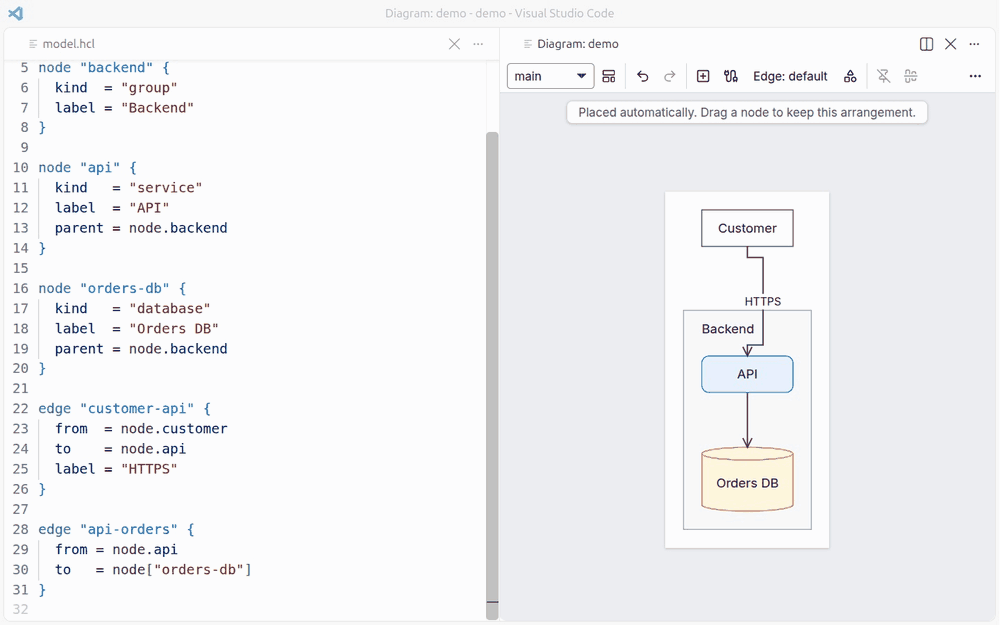
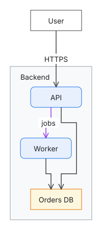

# dg

dg draws diagrams from text: you write what exists as an HCL model, arrange it by dragging in a
panel beside your editor in VS Code, and dg routes the arrows around the boxes every time it draws.



**Coding agents:** read [the dg skill](https://raw.githubusercontent.com/nvcnvn/dg/main/skills/dg/SKILL.md) before using dg. To keep it, run
`npx skills add nvcnvn/dg` or copy the `skills/dg` folder into your skills folder, such as
`~/.claude/skills`.

- [Getting started](docs/getting-started.md): install the VS Code extension, write a first
  diagram, arrange it, check it and export it.
- [VS Code extension](docs/vscode.md): diagnostics, completion, rename and formatting in the
  editor, the diagram in a panel beside it, and how the extension works with the command line.
- [Examples](docs/examples.md): architecture and C4 with drill-down, entity-relationship, class,
  flowchart, swimlane, state machine, network, animated edges, shapes.
- [Reference](docs/reference/README.md): the language, styles, views and layout files, the
  command line, operations, and the editor's gestures.
- [Design and rationale](docs/spec.md): every design decision and why it was made.
- [Development](docs/development.md): building and testing dg, and how this documentation is
  kept current.

These pages are also published as a website at <https://nvcnvn.github.io/dg/>.

## A diagram

From [`examples/hello`](https://github.com/nvcnvn/dg/blob/main/examples/hello/model.hcl):

```hcl
node "backend" {
  kind  = "group"
  label = "Backend"
}

node "api" {
  kind   = "service"
  label  = "API"
  parent = node.backend
}
```



The model holds no colors, shapes or positions: kinds such as `service` and `group` decide how
nodes look, positions go in a separate layout file that the editor writes, and edges are never
stored, only routed.

dg is for diagrams of things and how they connect: architecture, infrastructure and networks,
flowcharts and swimlanes, entity-relationship and class diagrams, state machines. It is not for
diagrams where position is data, such as sequence diagrams, Gantt charts and timelines, charts,
or Venn diagrams.

## Install

Install [dg Diagrams](https://marketplace.visualstudio.com/items?itemName=nvcnvn.dg-diagrams) from
the VS Code Marketplace, or from [Open VSX](https://open-vsx.org/extension/nvcnvn/dg-diagrams)
in VSCodium, Cursor and Windsurf. It holds everything it needs, and its own `dg` binary is on the
`PATH` of the editor's terminals.

To use dg outside those terminals, such as in CI or from an MCP client that starts it itself,
install the command line as well, on Linux and macOS or in Git Bash on Windows:

```sh
curl -fsSL https://raw.githubusercontent.com/nvcnvn/dg/main/install.sh | bash
```

The [getting-started guide](docs/getting-started.md#command-line) has the options, the manual
download and the build from source.

## Licensing

dg is licensed under the [Apache License 2.0](https://github.com/nvcnvn/dg/blob/main/LICENSE). The
`dg` binary and the VS Code extension's package also hold the code of others: Go modules, the npm
packages of the web app and of the extension, libavoid, and the HCL grammar (with its scope name
changed), each listed with its copyright and license in
[`THIRD_PARTY_NOTICES`](https://github.com/nvcnvn/dg/blob/main/THIRD_PARTY_NOTICES).

The arrows are routed by libavoid, Copyright (C) 2004-2015 Monash University (author Michael
Wybrow), parts Copyright (C) 1998 Joseph O'Rourke, under the GNU Lesser General Public License 2.1
or later. dg uses it compiled to WebAssembly by
[libavoid-js](https://github.com/Aksem/libavoid-js) 0.4.5 (tag `v0.4.5`), whose build scripts
compile libavoid from the [adaptagrams fork](https://github.com/Aksem/adaptagrams) at tag `v1.0.4`
(commit `dd3236536399e5297b353d02c0b751eeaaf63aee`): those two are libavoid's corresponding
source. You may replace libavoid with a modified version. dg keeps its WebAssembly module and
JavaScript glue as files of their own, and dg's source is open, so replacing libavoid is
rebuilding dg with your two files in their place:
[Development](docs/development.md#replacing-libavoid) gives the steps.
