# Examples

Each example is a project in the `examples` directory of the repository. The pictures are
`dg export` output of those projects, regenerated whenever the drawing changes. To open one in the
editor, run `dg serve -C examples/<name>` from the repository; `dg export -C examples/<name>`
draws it.

- [Architecture: a C4 container diagram](#architecture-a-c4-container-diagram)
- [C4 at three levels, with drill-down](#c4-at-three-levels-with-drill-down)
- [Animated edges](#animated-edges)
- [Entity-relationship diagram](#entity-relationship-diagram)
- [Class diagram](#class-diagram)
- [Flowchart](#flowchart)
- [Swimlanes](#swimlanes)
- [State machine](#state-machine)
- [Network and infrastructure](#network-and-infrastructure)
- [Incident board: overlays and decorations](#incident-board-overlays-and-decorations)
- [Shapes and styles](#shapes-and-styles)
- [Labels: subtitles, and a label per view](#labels-subtitles-and-a-label-per-view)
- [An installed pack](#an-installed-pack)

## Architecture: a C4 container diagram

[`examples/c4-container`](https://github.com/nvcnvn/dg/blob/main/examples/c4-container/model.hcl) is the container diagram of the C4
model's Internet Banking System. It brings its own vocabulary as a local pack, listed in
`dg.hcl`: kinds such as `c4-person`, `app`, `store` and `boundary`, and their styles. The system
is a container node that holds its containers:

```hcl
node "banking" {
  kind  = "boundary"
  label = "Internet Banking System\n[Software System]"
}

node "web-app" {
  kind   = "app"
  parent = node.banking
  label  = "Web Application\n[Container: Java and Spring MVC]\n\nDelivers the static content and the Internet banking single page application."
}
```

`\n` breaks a label into lines; longer lines wrap at the style's `max_w`, or at a pinned width. The pack's kinds are
plain declarations, and their look is in its `style.hcl`:

```hcl
kind "app" {}

kind "store" {}

kind "boundary" {
  container = true
}

edge_kind "uses" {}
```

Nothing is pinned in the view `main`, so dg lays it out:

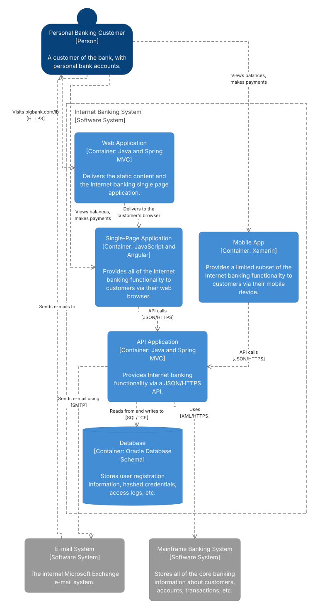

The view `pinned` shows the same nodes with a layout file that pins some of them; dg places the
others around them, and every edge is routed around the boxes:

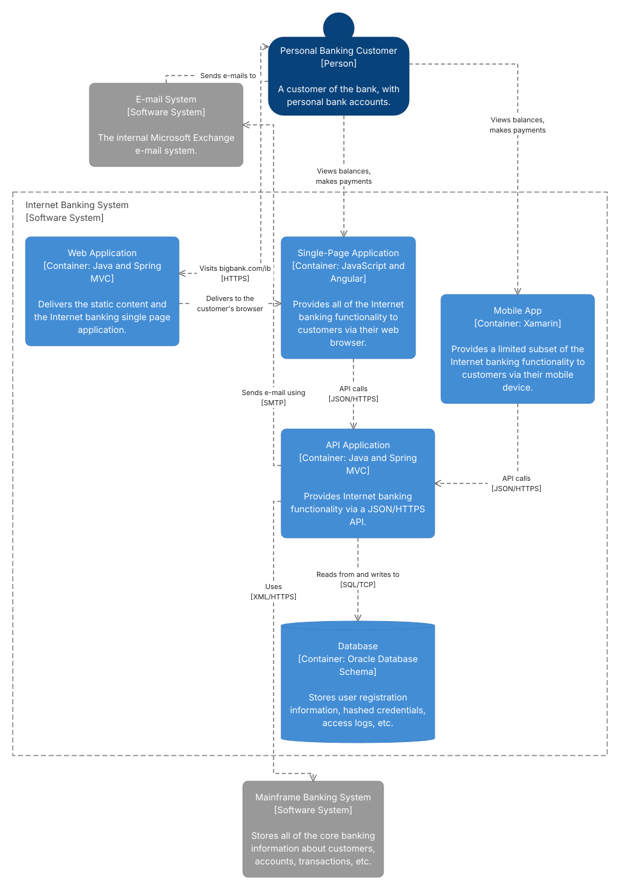

## C4 at three levels, with drill-down

[`examples/c4`](https://github.com/nvcnvn/dg/blob/main/examples/c4/views.hcl) holds one model of the same system down to the
components of its API, and three views of it. Relationships are written between the most
detailed elements; a view that collapses a system or a container lifts them to the box it draws,
and merges the edges that then join the same two boxes.

```hcl
view "main" {
  title    = "Internet Banking System: system context"
  collapse = [kind.system]
}
```

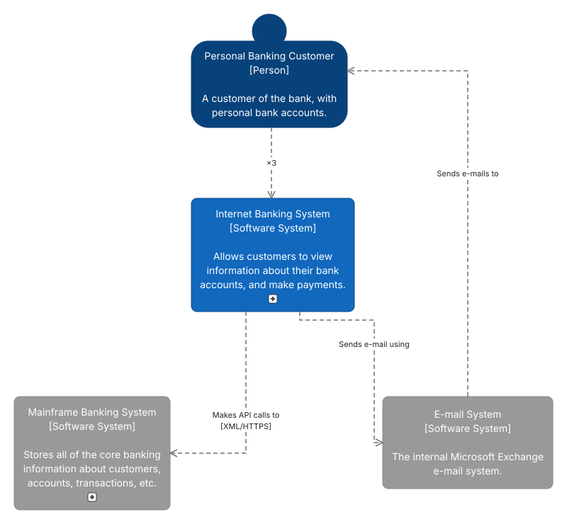

A view with `of` shows the inside of a container. In the editor, the container then has a
drill-down badge in every other view that opens it, and the view has breadcrumbs back:

```hcl
view "containers" {
  title    = "Internet Banking System: containers"
  of       = node.banking
  include  = [descendants.banking, node.banking, node.customer, node.mainframe, node.email]
  collapse = [node.api, node.mainframe]

  style "node.banking" {
    shape       = "rect"
    fill        = "none"
    stroke      = "#444444"
    stroke_dash = [8, 4]
    text_color  = "#444444"
    padding     = 20
  }
}
```

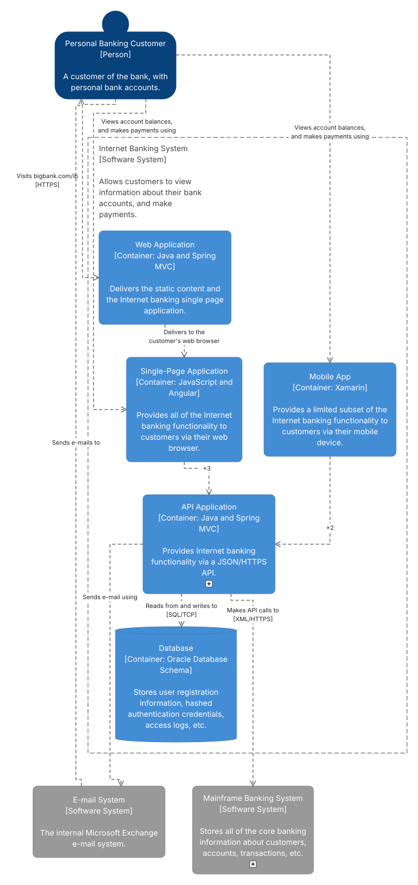

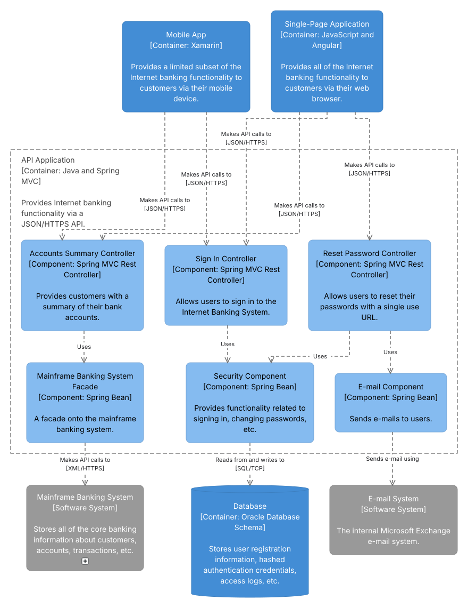

The view style rule `style "node.banking"` draws the system as a dashed boundary in this view
only; the context view draws it as a filled box.

## Animated edges

Animation is a style: an edge style with `animate = "flow"` moves dashes along its edges from
`from` to `to`. In [`examples/c4-container`](https://github.com/nvcnvn/dg/blob/main/examples/c4-container/packs/c4/style.hcl) the
edge kind `interaction` is a step of a dynamic diagram:

```hcl
edge_style "interaction" {
  stroke    = "#1168BD"
  font_size = 11
  animate   = "flow"
}
```

and the view `sign-in` shows only those edges:

```hcl
view "sign-in" {
  title   = "Internet Banking System: signing in"
  include = [node.customer, node.banking, node.spa, node.api, node.database]
  edges   = [edge_kind.interaction]
}
```

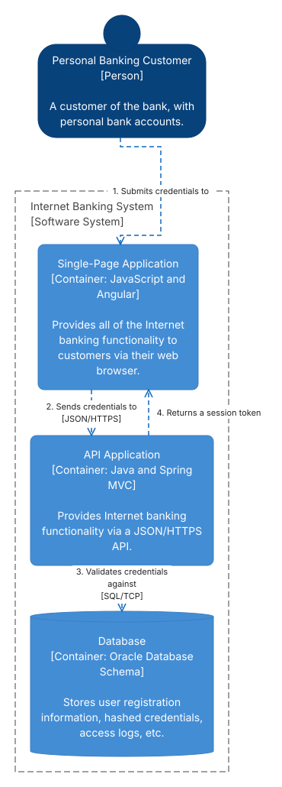

An exported SVG keeps the animation as CSS; `--format gif` exports one looping period of it, and
`--format png` the drawing at its start.

## Entity-relationship diagram

In [`examples/er`](https://github.com/nvcnvn/dg/blob/main/examples/er/model.hcl) each table is a node of the kind `table` with `row`
blocks. A row is also a port: an edge from `node.orders.row.customer_id` attaches at the end of
that row facing the other table. Crow's-foot cardinality comes from the generic pack's edge tags,
`start-…` for the `from` end and `end-…` for the `to` end:

```hcl
node "orders" {
  kind = "table"
  row "id" {
    type = "uuid"
    key  = "PK"
  }
  row "customer_id" {
    type = "uuid"
    key  = "FK"
  }
```

```hcl
edge "order-customer" {
  from = node.orders.row.customer_id
  to   = node.customers.row.id
  tags = ["start-zero-many", "end-one"]
}
```

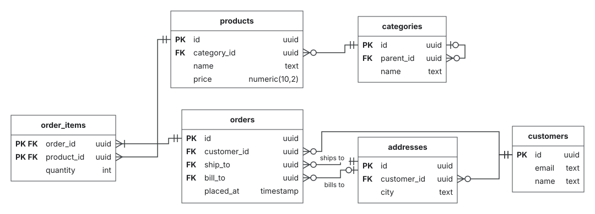

## Class diagram

[`examples/class`](https://github.com/nvcnvn/dg/blob/main/examples/class/model.hcl) uses the kind `class`, whose rows are grouped in
compartments, and the generic pack's edge kinds `inherits`, `realizes`, `composition`,
`aggregation` and `association`. Labels at the ends of an edge hold multiplicities:

```hcl
node "Payment" {
  kind = "class"
  compartment "fields" {
    row "amount" {
      type = "Money"
    }
  }
  compartment "methods" {
    row "pay()" {
      type = "Receipt"
    }
  }
}
```

```hcl
edge "places" {
  from   = node.Customer
  to     = node.Order
  kind   = "association"
  labels = { start = "1", mid = "places", end = "0..*" }
}
```

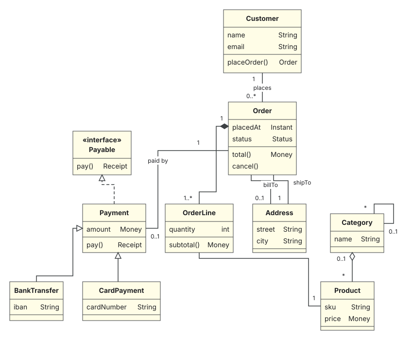

The first layout puts a general class above the classes that inherit from it.

## Flowchart

[`examples/flowchart`](https://github.com/nvcnvn/dg/blob/main/examples/flowchart/model.hcl) uses the generic pack's `terminal`,
`decision` and `node` kinds. The checks that run in parallel are in a `grid-group`, a container
that places its children in a grid; the view's style rule makes it two centered columns:

```hcl
view "main" {
  title = "Pull request pipeline"

  # Two centered columns of checks.
  style "node.checks" {
    align   = "center"
    columns = 2
    gap     = 20
  }
}
```

The view's [layout file](https://github.com/nvcnvn/dg/blob/main/examples/flowchart/views/main.layout.yaml) stores the order of the
checks and an edge hint that makes the loop back leave the bottom of "Push a fix" and enter the
checks from the left. The loop back stays a loop back: the first layout runs from the start of
the flow.

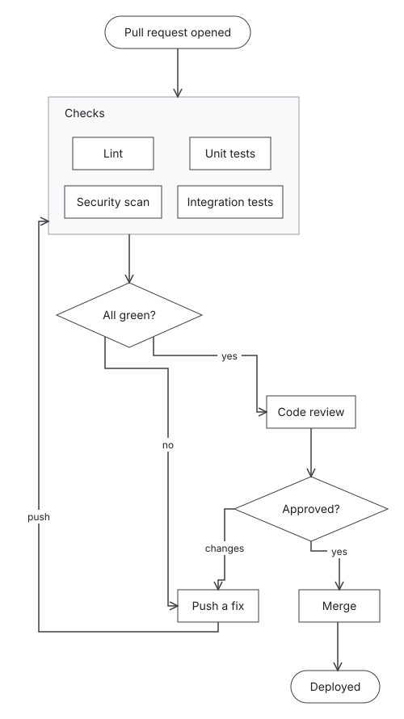

## Swimlanes

In [`examples/swimlane`](https://github.com/nvcnvn/dg/blob/main/examples/swimlane/model.hcl) a `lane-set` (a pool) stacks its `lane`
children, each labeled along its left edge, and each lane holds its steps placed freely. The
first layout lines the steps up across the lanes in the order the edges run:

```hcl
node "fulfilment" {
  kind  = "lane-set"
  label = "Order fulfilment"
}

node "customer" {
  kind   = "lane"
  label  = "Customer"
  parent = node.fulfilment
}
```

The order of the lanes is in the view's layout file (`fulfilment: {order: [customer, sales,
warehouse, billing]}`); dragging a lane in the editor reorders it.

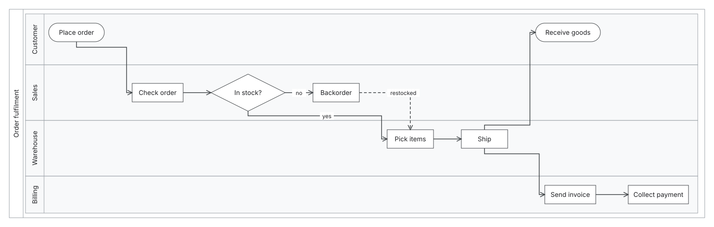

## State machine

[`examples/state-machine`](https://github.com/nvcnvn/dg/blob/main/examples/state-machine/model.hcl) uses `initial`, `final` and
`simple-state` from the generic pack. A state with concurrent regions is a project kind that
extends `state` and stacks its children:

```hcl
kind "regions" {
  extends = "state"
}

kind "region" {
  container = true
}
```

```hcl
style "regions" {
  padding   = 10
  layout    = "stack"
  direction = "vertical"
  gap       = 0
  stretch   = true
}
```

A self-transition is an edge from a node to itself:

```hcl
edge "created-edit" {
  from  = node.created
  to    = node.created
  label = "edit"
}
```

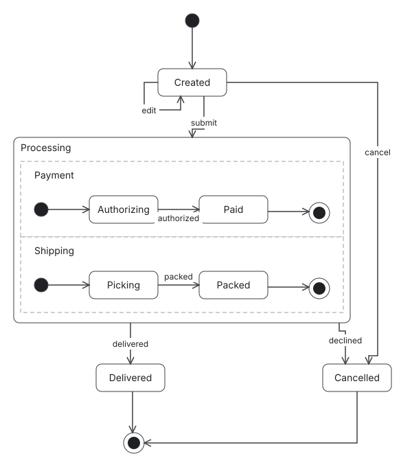

## Network and infrastructure

[`examples/inference`](https://github.com/nvcnvn/dg/blob/main/examples/inference/dg.hcl) models an inference cluster with a local
pack of kinds that have ports and typed properties, a hand-written model, and a generated model
that dg never writes:

```hcl
project "inference" {
  packs     = ["generic", "packs/inference"]
  models    = ["model.hcl", "generated/*.hcl"]
  read_only = ["generated/*.hcl"]
}
```

```hcl
kind "gpu-node" {
  ports             = ["nic0", "nic1"]
  default_port_side = "auto"
  property "gpu_count" {
    type    = number
    default = 8
  }
}
```

A node can add its own ports, here 8 of them with `port_range`, and an edge can end at a port:

```hcl
node "tor-1" {
  kind  = "switch"
  label = "ToR 1"
  ports = port_range("p", 1, 8)
  props = { speed = "400G" }
}
```

```hcl
edge "w1-tor" {
  from  = node.worker-1.port.nic0
  to    = node.tor-1.port.p1
  kind  = "rdma"
  label = "400G"
}
```

Two views select by kind and edge kind: the request path, and the RDMA fabric. The fabric's
[layout file](https://github.com/nvcnvn/dg/blob/main/examples/inference/views/rdma.layout.yaml)
pins the switch's ports `p1` and `p2` apart along its top and `p8` on its bottom; ports are
points on a node's border, not drawn themselves, so each edge ends where its port is.

```hcl
view "rdma" {
  title   = "RDMA fabric"
  include = [kind.gpu-node, kind.switch, kind.storage]
  edges   = [edge_kind.rdma]
}
```

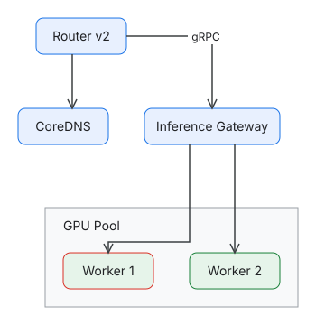

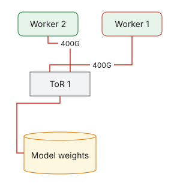

## Incident board: overlays and decorations

[`examples/incident`](https://github.com/nvcnvn/dg/blob/main/examples/incident/views.hcl) draws a checkout platform, and an incident
view of it: a collapsed data tier, an overlay outlining every node tagged `degraded`, view style
rules that apply only in this view, and an animated edge.

```hcl
view "incident" {
  title    = "Incident: payment provider timeouts"
  collapse = [node.data]

  overlay "blast-radius" {
    members = [tag.degraded]
    style   = "hull-red"
    label   = "Blast radius"
  }

  style "tag.degraded" {
    fill   = "#FCE8E6"
    stroke = "#D93025"
  }

  style "node.payments" {
    stroke_width = 3
  }

  edge_style "edge.payments-psp" {
    stroke  = "#D93025"
    animate = "flow"
  }
}
```

The title band, the icon, the legend and the notes around the payment provider are decorations
in the view's [layout file](https://github.com/nvcnvn/dg/blob/main/examples/incident/views/incident.layout.yaml): drawing that
belongs to the view, not the model. Some are attached to a node and move with it.

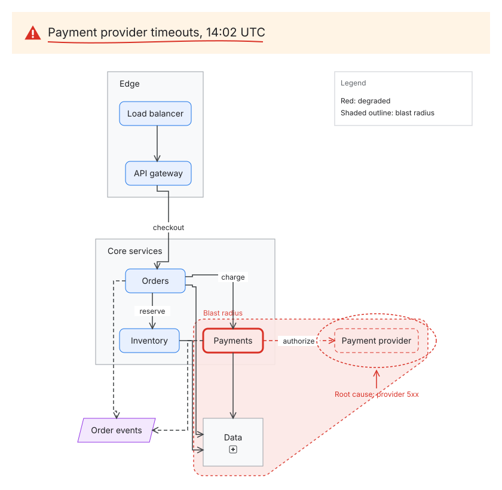

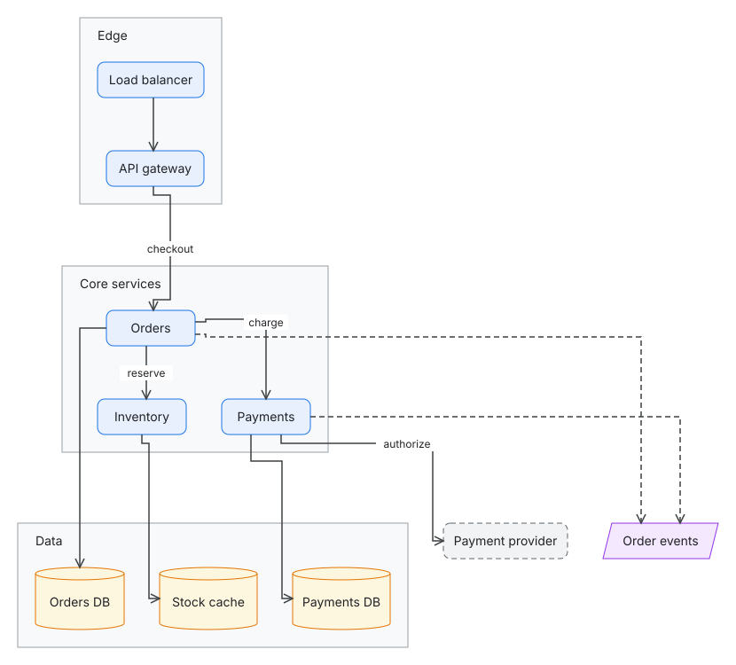

## Shapes and styles

[`examples/shapes`](https://github.com/nvcnvn/dg/blob/main/examples/shapes/style.hcl) draws every built-in shape, two custom shapes
from SVG files with anchors for their ports, an icon, and the node and edge style properties.

```hcl
shape "chip" {
  svg      = file("shapes/chip.svg")
  text_box = [0.15, 0.15, 0.7, 0.7]
  anchors  = { in = [0, 0.5], out = [1, 0.5] }
  stretch  = "uniform"
}
```

```hcl
edge_style "tag.straight" {
  routing     = "straight"
  arrow_start = "circle"
  arrow_end   = "circle-open"
}
```

The view `gallery` shows the shapes and node styles in a grid that its layout file pins:

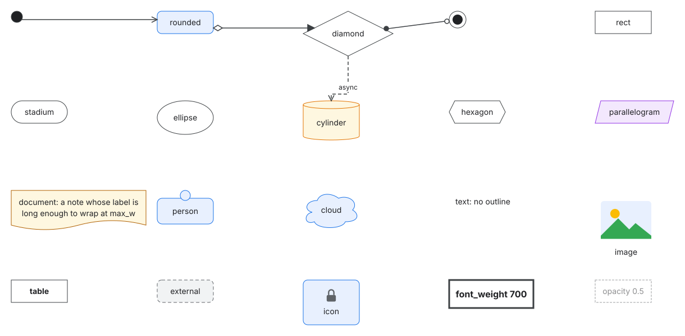

The view `wiring` pins nodes and a port, and gives edges hints: the sides they leave and enter
by, a point to pass through, and where the label sits.

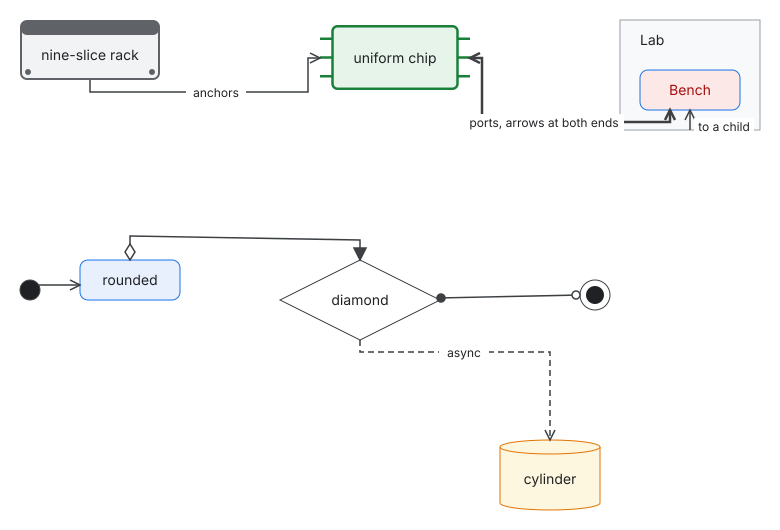

## Labels: subtitles, and a label per view

[`examples/labels`](https://github.com/nvcnvn/dg/blob/main/examples/labels/views.hcl) draws one
model twice. The style draws what follows the first line break of a label as a subtitle:

```hcl
style "node" {
  font_weight     = 600
  sub_font_size   = 11
  sub_font_weight = 400
  sub_text_color  = "#5F6368"
}
```

The view `main` shows the model's labels, and `sizing` gives three nodes labels of its own, with
no second set of nodes in the model:

```hcl
view "sizing" {
  title = "How large it is"

  node "gateway" {
    label = "Inference gateway\n3 replicas, 2 vCPU each"
  }
  node "workers" {
    label = "Workers\n8 nodes, 8 GPUs each"
  }
  node "storage" {
    label = "Model storage\n200 TB NVMe"
  }
}
```

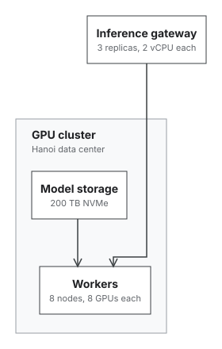

## An installed pack

[`examples/installed-pack`](https://github.com/nvcnvn/dg/blob/main/examples/installed-pack/dg.hcl) draws a home network with a pack that
`dg pack add` installed. The pack is the example's own, with original icons. Its source is
illustrative: `example.com` holds no repository, so `dg pack install` and `dg pack update` cannot
reach it. What draws the example is the copy in `packs/homelab`, which `dg check` compares with the
hash in `dg.lock`:

```hcl
project "installed-pack" {
  pack "homelab" {
    source  = "example.com/homelab"
    version = "v1.0.0"
  }
}
```

The pack writes short names and sorts its kinds into the palette's categories:

```hcl
kind "router" {
  category = "Network"
}
```

To the project each name has the pack's prefix, in the model as in its own `style.hcl`, which
overrides the fill of the pack's `server`:

```hcl
node "hypervisor" {
  kind   = "homelab-server"
  parent = node.cabinet
  label  = "Hypervisor"
}
```

```hcl
style "homelab-server" {
  fill = "#E6F4EA"
}
```

The cabinet is a container drawn with the pack's custom shape, and the edges use its edge kinds:

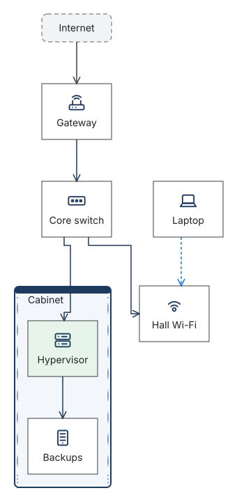

[Packs](packs.md) covers installing packs and writing one.
