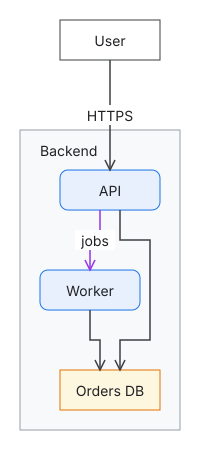

# Getting started

This guide builds dg, writes a small diagram, checks it, arranges it in the browser and exports
it as a picture.

## Install

Download the archive for your platform from the
[releases page](https://github.com/nvcnvn/dg/releases), unpack it, and copy `dg` to a directory
on your `PATH`. It is a single binary that holds everything it needs at run time: dg never uses
the network. To draw pictures, `dg export` also needs Google Chrome or Chromium, which it drives
headless.

### Build from source

You need:

- Go 1.27 or newer,
- Node.js 20.19 or newer (on Node.js 22, 22.12 or newer) with npm, which builds the web app that
  dg embeds,
- `git` and `make`.

```sh
git clone https://github.com/nvcnvn/dg.git
cd dg
make build
export PATH="$PWD/bin:$PATH"
dg --help
```

`make build` builds the web app and then `bin/dg`. Add `bin` to your `PATH` in your shell's
profile, or copy `bin/dg` to a directory already on it.

`go install github.com/nvcnvn/dg/cmd/dg@latest` does not work: the web app the binary embeds is
built output that the repository does not hold.

## Write a model

A dg project is a directory of HCL files. Create one outside the clone of dg, for example in your
home directory (`cd ~` first):

```sh
mkdir hello
cd hello
echo 'project "hello" {}' > dg.hcl
```

`dg.hcl` is the project file. Every setting in it is optional and the file itself is too, but
it is how the [VS Code extension](vscode.md) knows the folder is a dg project.

Save this as `model.hcl`:

```hcl
node "user" {
  label = "User"
}

node "backend" {
  kind  = "group"
  label = "Backend"
}

node "api" {
  kind   = "service"
  label  = "API"
  parent = node.backend
}

node "worker" {
  kind   = "service"
  label  = "Worker"
  parent = node.backend
}

node "orders-db" {
  kind   = "database"
  label  = "Orders DB"
  parent = node.backend
}

edge "user-api" {
  from  = node.user
  to    = node.api
  label = "HTTPS"
}

edge "api-worker" {
  from  = node.api
  to    = node.worker
  kind  = "async"
  label = "jobs"
}

edge "api-db" {
  from = node.api
  to   = node["orders-db"]
}

edge "worker-db" {
  from = node.worker
  to   = node["orders-db"]
}
```

Each `node` and `edge` block is labeled with its ID. The ID never changes when the label does,
and nothing in it says where a node sits: `parent = node.backend` puts the API inside the
backend, which can hold other nodes because its kind, `group`, is a container. `service`,
`database`, `group` and `async` are kinds of the built-in [generic pack](reference/styles.md#the-generic-pack);
the kind decides how a node is drawn, so the model holds no colors, shapes or positions.

Styles change how kinds look. Save this as `style.hcl` to draw asynchronous edges purple:

```hcl
edge_style "async" {
  stroke = "#9334E6"
}
```

The same files are in [`examples/hello`](https://github.com/nvcnvn/dg/blob/main/examples/hello/model.hcl).

## Check it

```sh
dg check
```

It prints:

```text
style.hcl:1:1: info: Overridden definition: The edge_style "async" overrides the properties it sets of the one defined at <generic>/style.hcl:169:1.
```

`dg check` reports errors, warnings and information with file, line and column, and exits with 1
when there are errors. This project has one piece of information: `style.hcl` overrides the color
of the generic pack's `async` edges, as intended. A mistake, such as `parent = node.backnd`, is an
error naming the line.

## See and arrange it

```sh
dg serve
```

`dg serve` opens the editor in your browser. With nothing arranged yet, the view is laid out
automatically:



Drag the Worker 100 pixels to the right. The first drag pins every node where it is drawn, and
dg writes the positions to `views/main.layout.yaml`, the layout file of the view `main` (a
project without views has that one view of everything):

<!-- begin generated getting-started-layout: go test ./cmd/dg -run TestDocs -update -->

```yaml
version: 1
place:
  api: {in: backend, x: 20, y: 0}
  backend: {x: 10, y: 120}
  orders-db: {in: backend, x: 20, y: 200}
  user: {x: 50, y: 10}
  worker: {in: backend, x: 100, y: 100}
```

<!-- end getting-started-layout -->

Positions are on a 10-pixel grid and relative to the container a node is in, so moving the
backend changes one line. Edges are not in the file: they are routed around the boxes every time
the view is drawn.

Keep the browser open and edit `model.hcl` in a text editor: when you save, the drawing updates.
The editor also edits the model itself: drag a kind from the palette to create a node, press C to
draw edges, double-click a label to change it. [The editor reference](reference/editor.md) lists
every gesture. Stop `dg serve` with Ctrl+C.

## Export it

```sh
dg export --format svg --out hello.svg
dg export --format png --out hello.png
```

`dg export` draws a view in headless Chrome exactly as the editor does and writes SVG, PNG, an
animated GIF or JSON geometry. `--view` picks a view other than `main`, and `--all --out <dir>`
writes every view.

`dg fmt` formats the HCL files and layout files the way dg writes them; run it before you commit.

## Next steps

- [Examples](examples.md) shows each kind of diagram dg draws, with its HCL.
- [Views](reference/views.md) explains how to show part of a model, collapse containers and open
  one view from another.
- [Styles](reference/styles.md) lists the shapes, colors and arrowheads, and how to define your
  own kinds.
- [`dg op`](reference/operations.md) and [`dg mcp`](reference/cli.md#dg-mcp) let scripts and
  agents edit the files with the same operations as the editor.
