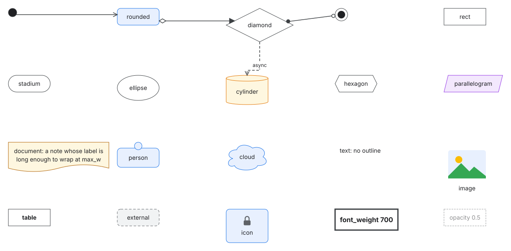

# Styles

Styles decide how nodes, edges and overlays look; the model only names kinds and tags. Style
blocks live in a pack's or the project's `style.hcl`, or inside a view, where they apply to that
view only (see [view style rules](views.md#view-style-rules)).

<!-- begin generated toc: go test ./cmd/dg -run TestDocs -update -->

- [Style rules](#style-rules)
- [The cascade](#the-cascade)
- [Node style properties](#node-style-properties)
  - [Container properties](#container-properties)
- [Edge style properties](#edge-style-properties)
- [Overlay style properties](#overlay-style-properties)
- [Shapes](#shapes)
  - [Custom shapes](#custom-shapes)
- [Arrow markers](#arrow-markers)
- [Animation](#animation)
- [The generic pack](#the-generic-pack)

<!-- end toc -->

## Style rules

```hcl
# nodes of the kind service and of the kinds that extend it
style "service" {
  shape  = "rounded"
  fill   = "#E8F0FE"
  stroke = "#1A73E8"
}

# nodes tagged deprecated
style "tag.deprecated" {
  stroke_dash = [4, 4]
  opacity     = 0.6
}

# edges of the kind rdma
edge_style "rdma" {
  stroke    = "#D93025"
  arrow_end = "none"
}

# a named style for view overlays
overlay_style "hull-red" {
  stroke  = "#D93025"
  fill    = "#FCE8E6"
  padding = 16
}
```

The label of a `style` or `edge_style` block selects what it applies to:

| Label | Applies to |
|---|---|
| `"service"` | nodes of the kind `service` and of every kind that extends it (for `edge_style`, edges of that edge kind) |
| `"tag.deprecated"` | nodes (edges) with the tag `deprecated` |
| `"node.kvstore"`, `"edge.api-db"` | one node or edge; only in a view |

`overlay_style` blocks are named styles that an overlay picks with `style = "<name>"`, and
`shape` blocks define [custom shapes](#custom-shapes).

## The cascade

Each property of a node or edge comes from the last of these that sets it:

1. the styles of its kind's ancestors, from the root (`node`, or `default` for edges) down;
2. the style of its own kind;
3. the styles of its tags, in the order the element lists its tags;
4. in a view, the view's rules: kind rules, then tag rules, then `node.<id>` or `edge.<id>` rules.

The generic pack's `style "node"` and `edge_style "default"` set every property that has a
default, so every property always has a value.

## Node style properties

Colors are `"#RGB"`, `"#RRGGBB"` or `"none"`. Sizes are in pixels.

<!-- begin checked style-properties: TestDocs checks that these tables list every property of internal/style -->

| Property | Values | Effect |
|---|---|---|
| `shape` | a built-in shape (`rect`, `rounded`, `stadium`, `ellipse`, `diamond`, `cylinder`, `hexagon`, `parallelogram`, `document`, `person`, `cloud`, `text`, `image`, `point`, `bullseye`, `table`) or a custom shape's name | the outline (see [shapes](#shapes)) |
| `fill` | color or `none` | the inside |
| `stroke` | color or `none` | the outline |
| `stroke_width` | number, at least 0 | the outline's width |
| `stroke_dash` | list of numbers, at least 0, such as `[4, 4]`; `[]` is solid | dashes of the outline |
| `corner_radius` | number, at least 0 | the corners of `rounded` |
| `opacity` | number from 0 to 1 | the whole node |
| `text_color` | color or `none` | the label and rows |
| `font_size` | number, at least 1 | the label and rows |
| `font_weight` | 100, 200, … 900 | up to 500 is drawn regular, 600 and above bold |
| `sub_font_size` | number, at least 1 | the label after its first line break; unset: `font_size` |
| `sub_font_weight` | 100, 200, … 900 | the label after its first line break; unset: `font_weight` |
| `sub_text_color` | color or `none` | the label after its first line break; unset: `text_color` |
| `icon` | `file("….svg")` | a picture above the label, twice `font_size` square |
| `image` | `file("….svg")` | the picture of the `image` shape |
| `padding` | number, at least 0 | room between the outline and the label, rows or children |
| `min_w`, `min_h` | number, at least 0 | the smallest size the node is drawn at |
| `max_w` | number, at least 0 | labels wrap to fit this width, padding included; `0` never wraps |
| `z` | whole number | draw order among containers, and among other nodes |

Labels break at `\n` and wrap at word boundaries; lines are `1.4 × font_size` apart, rounded up.
Containers are drawn before the nodes they can hold, so `z` orders containers among containers
and other nodes among other nodes; edges are drawn over every node.

### Container properties

These properties arrange the children of a container; see
[container policies](views.md#container-policies) for how.

| Property | Values | Effect |
|---|---|---|
| `layout` | `free` (default), `stack` or `grid` | who places the children: themselves, or the container in a row or a grid |
| `direction` | `vertical` or `horizontal` | the way a stack runs |
| `gap` | number, at least 0 | room between stacked children or grid cells |
| `stretch` | `true` or `false` | in a stack, children all take its full width (height, for `horizontal`) |
| `columns` | whole number, at least 1 | the columns of a grid |
| `align` | `start`, `center` or `end` | children aligned across a stack, or in their grid cells |
| `label_side` | `top` or `left` | `left` draws the label turned a quarter counterclockwise along the left edge, as on a swimlane |

<!-- end style-properties -->

## Edge style properties

<!-- begin checked edge-style-properties -->

| Property | Values | Effect |
|---|---|---|
| `stroke` | color or `none` | the line and its markers |
| `stroke_width` | number, at least 0 | the line's width |
| `stroke_dash` | list of numbers, at least 0 | dashes of the line; markers are never dashed |
| `arrow_start` | an [arrow marker](#arrow-markers): `none`, `arrow`, `triangle`, `triangle-open`, `diamond`, `diamond-open`, `circle`, `circle-open`, `crow-one`, `crow-zero-one`, `crow-many`, `crow-one-many`, `crow-zero-many` | the marker at `from` |
| `arrow_end` | an [arrow marker](#arrow-markers): `none`, `arrow`, `triangle`, `triangle-open`, `diamond`, `diamond-open`, `circle`, `circle-open`, `crow-one`, `crow-zero-one`, `crow-many`, `crow-one-many`, `crow-zero-many` | the marker at `to` |
| `routing` | `orthogonal` (default), `polyline` or `straight` | horizontal and vertical segments; segments at any angle; or one straight line, through anything |
| `font_size` | number, at least 1 | the edge's labels |
| `animate` | `none` (default) or `flow` | see [animation](#animation) |

<!-- end edge-style-properties -->

## Overlay style properties

An overlay is drawn with `overlay_style "hull"`, overridden by the properties of the overlay style
it names.

<!-- begin checked overlay-style-properties -->

| Property | Values | Effect |
|---|---|---|
| `fill` | color or `none` | the inside of the outline |
| `stroke` | color or `none` | the outline and the overlay's label |
| `stroke_width` | number, at least 0 | the outline's width |
| `stroke_dash` | list of numbers, at least 0 | dashes of the outline |
| `opacity` | number from 0 to 1 | the whole overlay |
| `padding` | number, at least 0 | room between the members' boxes and the outline, and its corners' radius |

<!-- end overlay-style-properties -->

## Shapes



| Shape | Drawn as |
|---|---|
| `rect` | a rectangle |
| `rounded` | a rectangle with corners of `corner_radius` |
| `stadium` | a rectangle with half-circle ends |
| `ellipse`, `diamond`, `hexagon`, `parallelogram`, `cloud` | the named outline around the label |
| `cylinder` | a database cylinder |
| `document` | a page with a wavy bottom edge |
| `person` | a head above a rounded body that holds the label |
| `text` | the label alone, without an outline |
| `image` | the style's `image` picture above the label, at least six times `font_size` square, without an outline |
| `point` | a filled dot without a label, sized by `min_w` and `min_h`: junctions, initial states |
| `bullseye` | a dot in a ring without a label: final states |
| `table` | a box with the label above the node's rows and compartments; a node without rows is a `rect` |

Edges end on the outline of each shape. Pictures (`icon`, `image` and custom shapes) are SVG files
read with `file()`: well-formed XML whose root is an `svg` element in the SVG namespace. Other
picture formats are not supported.

### Custom shapes

A `shape` block draws nodes with an SVG picture:

```hcl
shape "chip" {
  svg      = file("shapes/chip.svg")
  text_box = [0.15, 0.15, 0.7, 0.7]
  anchors  = { in = [0, 0.5], out = [1, 0.5] }
  stretch  = "uniform"
}

style "chip" {
  shape = "chip"
}
```

- `text_box` is where the label goes: `x`, `y`, `w` and `h` as fractions of the box, by default
  the whole box, `[0, 0, 1, 1]`.
- `anchors` places ports at points given as fractions of the box.
- Each name in `anchors` must be a port of every kind whose style uses the shape; other ports
  are placed as usual.
- `stretch`: `nine-slice` keeps the corners of the picture (a quarter of its width and height in
  from each edge) at their size and stretches the edges and middle; `uniform` scales the picture
  and keeps the box at its aspect ratio; `none` draws the picture at its size, centered.
- The picture's size is its `viewBox`, else its `width` and `height`, else 100 by 100.
- A shape's name cannot be a built-in shape's. The picture has its own colors: `fill` and `stroke`
  are not drawn.

## Arrow markers

`arrow_start` and `arrow_end` take:

| Marker | Drawn as |
|---|---|
| `none` | nothing |
| `arrow` | an open arrowhead (two lines) |
| `triangle`, `triangle-open` | a filled or hollow triangle (UML inheritance: `triangle-open`) |
| `diamond`, `diamond-open` | a filled or hollow diamond (UML composition and aggregation) |
| `circle`, `circle-open` | a filled or hollow circle |
| `crow-one` | two bars: exactly one |
| `crow-zero-one` | a bar, then a ring: zero or one |
| `crow-many` | a crow's foot: many |
| `crow-one-many` | a crow's foot, then a bar: one or many |
| `crow-zero-many` | a crow's foot, then a ring: zero or many |

Hollow markers are filled white; the others take the edge's `stroke`. Crow's-foot markers read
outward from the node. The generic pack's edge tags `start-one`, `end-zero-many` and so on set
them without a style of your own.

## Animation

`animate = "flow"` draws the edge dashed (with its `stroke_dash`, or `[6, 4]`) and moves the
dashes from `from` toward `to`, one dash period every half second. Every animated edge repeats
with the same half-second period. Animation is a style, so it is chosen by edge kind, tag or a
view rule, never set on an edge in the model:

```hcl
edge_style "tag.hot" {
  animate = "flow"
}
```

An exported SVG keeps the animation as CSS. A GIF holds one period in 10 frames and loops; a PNG
shows the edge still.

## The generic pack

The built-in `generic` pack is always loaded first. Its spec and style are
[`packs/generic/spec.hcl`](https://github.com/nvcnvn/dg/blob/main/packs/generic/spec.hcl) and
[`packs/generic/style.hcl`](https://github.com/nvcnvn/dg/blob/main/packs/generic/style.hcl); this section is generated from them.

- `person` draws a head above a rounded body holding the label.
- `lane-set` is a pool: it stacks its `lane` children, each labeled along its left edge.
- `grid-group` places its children in a grid of three columns.
- `state` is a state with substates; `simple-state` is one without.
- `initial`, `final` and `junction` draw no label.
- `table` and `class` hold rows; `class` draws them in compartments.

<!-- begin generated generic-pack: go test ./cmd/dg -run TestDocs -update -->

| Kind | Spec | Style |
|---|---|---|
| `node` |  | the defaults below |
| `service` |  | `shape = "rounded"`, `fill = "#E8F0FE"`, `stroke = "#1A73E8"` |
| `database` |  | `shape = "cylinder"`, `fill = "#FEF7E0"`, `stroke = "#E37400"` |
| `queue` |  | `shape = "parallelogram"`, `fill = "#F3E8FD"`, `stroke = "#9334E6"` |
| `storage` |  | `shape = "cylinder"`, `fill = "#FEF7E0"`, `stroke = "#E37400"` |
| `person` |  | `shape = "person"`, `fill = "#E8F0FE"`, `stroke = "#1A73E8"` |
| `external` |  | `shape = "rounded"`, `fill = "#F1F3F4"`, `stroke = "#5F6368"`, `stroke_dash = [6, 4]` |
| `note` |  | `shape = "document"`, `fill = "#FEF7E0"`, `stroke = "#B06000"` |
| `decision` |  | `shape = "diamond"` |
| `terminal` |  | `shape = "stadium"` |
| `initial` |  | `shape = "point"`, `fill = "#202124"`, `min_w = 20`, `min_h = 20` |
| `final` |  | `shape = "bullseye"`, `fill = "#202124"`, `min_w = 26`, `min_h = 26` |
| `simple-state` |  | `shape = "rounded"`, `fill = "#FFFFFF"`, `stroke = "#3C4043"` |
| `junction` |  | `shape = "point"`, `fill = "#3C4043"`, `min_w = 10`, `min_h = 10` |
| `group` | `container = true` | `fill = "#F8F9FA"`, `stroke = "#9AA0A6"`, `padding = 20` |
| `lane-set` | `container = true` | `fill = "#FFFFFF"`, `stroke = "#9AA0A6"`, `padding = 10`, `layout = "stack"`, `direction = "vertical"`, `gap = 0`, `stretch = true`, `label_side = "left"` |
| `lane` | `container = true` | `fill = "#F8F9FA"`, `stroke = "#9AA0A6"`, `padding = 20`, `label_side = "left"` |
| `grid-group` | `container = true` | `fill = "#F8F9FA"`, `stroke = "#9AA0A6"`, `padding = 20`, `layout = "grid"`, `columns = 3` |
| `state` | `container = true` | `shape = "rounded"`, `fill = "#FFFFFF"`, `stroke = "#3C4043"`, `padding = 20` |
| `table` | `rows = true` | `shape = "table"`, `padding = 8`, `font_weight = 700` |
| `class` | `rows = true` | `shape = "table"`, `fill = "#FFFDE7"`, `padding = 8`, `font_weight = 700` |

| Edge kind | Style |
|---|---|
| `default` | the defaults below |
| `async` | `stroke_dash = [6, 4]` |
| `association` | `arrow_end = "none"` |
| `inherits` | `arrow_end = "triangle-open"` |
| `realizes` | `stroke_dash = [6, 4]`, `arrow_end = "triangle-open"` |
| `composition` | `arrow_start = "diamond"`, `arrow_end = "none"` |
| `aggregation` | `arrow_start = "diamond-open"`, `arrow_end = "none"` |
| `dependency` | `stroke_dash = [6, 4]` |

| Edge tag | Style |
|---|---|
| `start-one` | `arrow_start = "crow-one"` |
| `start-zero-one` | `arrow_start = "crow-zero-one"` |
| `start-many` | `arrow_start = "crow-many"` |
| `start-one-many` | `arrow_start = "crow-one-many"` |
| `start-zero-many` | `arrow_start = "crow-zero-many"` |
| `end-one` | `arrow_end = "crow-one"` |
| `end-zero-one` | `arrow_end = "crow-zero-one"` |
| `end-many` | `arrow_end = "crow-many"` |
| `end-one-many` | `arrow_end = "crow-one-many"` |
| `end-zero-many` | `arrow_end = "crow-zero-many"` |

The defaults, which every other style overrides:

```hcl
style "node" {
  shape         = "rect"
  fill          = "#FFFFFF"
  stroke        = "#3C4043"
  stroke_width  = 1
  stroke_dash   = []
  corner_radius = 8
  opacity       = 1
  text_color    = "#202124"
  font_size     = 14
  font_weight   = 400
  padding       = 10
  min_w         = 100
  min_h         = 40
  max_w         = 240
  z             = 0
  layout        = "free"
  direction     = "vertical"
  gap           = 10
  stretch       = false
  columns       = 3
  align         = "start"
  label_side    = "top"
}

edge_style "default" {
  stroke       = "#3C4043"
  stroke_width = 1.5
  stroke_dash  = []
  arrow_start  = "none"
  arrow_end    = "arrow"
  routing      = "orthogonal"
  font_size    = 12
  animate      = "none"
}

overlay_style "hull" {
  fill         = "none"
  stroke       = "#5F6368"
  stroke_width = 1.5
  stroke_dash  = [4, 4]
  opacity      = 1
  padding      = 12
}
```

<!-- end generic-pack -->
