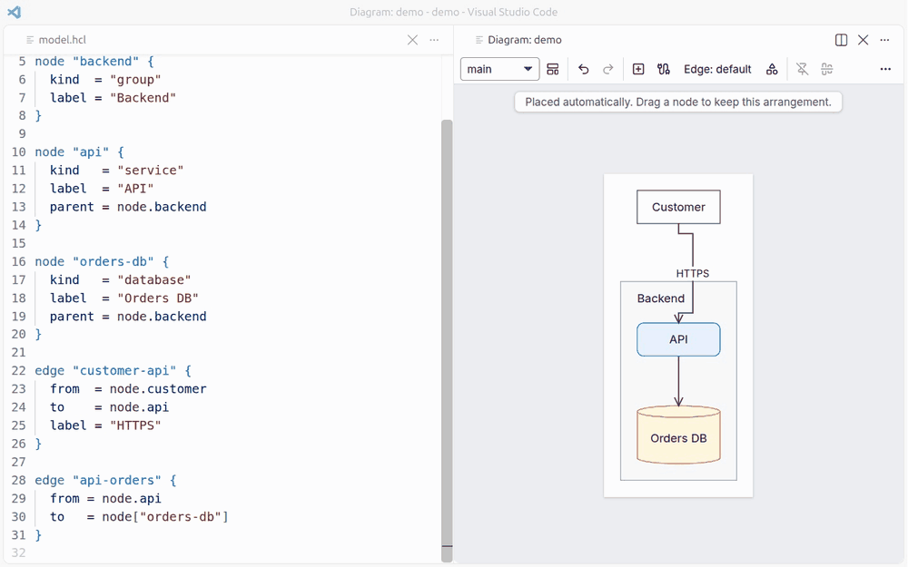
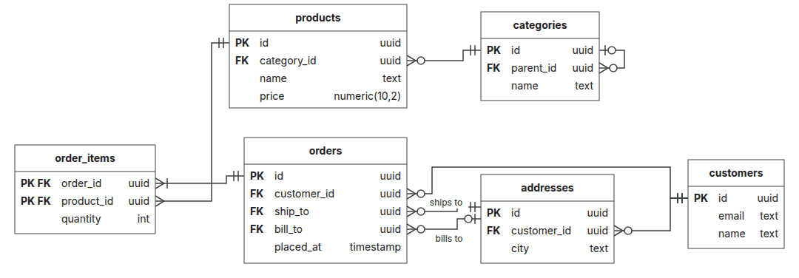

# dg Diagrams

Diagrams as code that you can still arrange by hand. Write what exists as text, drag it into place
in a panel beside your editor, and dg routes the arrows around the boxes every time it draws. Your
diagrams live in your repository as plain files that people and coding agents can both edit.



## Why model, style and layout are separate

Most diagram files mix what a system is with how it looks and where each box sits, so one small
change produces a diff nobody can read. dg keeps them apart:

| Part | Answers | Lives in | Written by |
|---|---|---|---|
| **Model** | What exists and how it connects | `*.hcl` | You or an agent |
| **Style** | How each kind of thing looks | `style.hcl` or a pack | You, once |
| **Layout** | Where things sit in each view | `views/*.layout.yaml` | The diagram panel |

Arrows are in none of them: they are routed each time the diagram is drawn. That gives you:

- **Diffs you can review.** Adding a service is a few lines of HCL. Dragging a box changes only a
  layout file, never the model.
- **One place to restyle.** The model says `kind = "database"` and the style decides that means a
  cylinder. Change the style once and every diagram follows, with no model edits.
- **One model, many views.** An overview and a detailed view for each team share the same
  elements, each with its own layout. Rename a node and every view follows.
- **Arrows that never go stale.** Move a box and its arrows route around whatever is in the way.

## Built for coding agents

A dg model holds no coordinates or colors, so an agent describes a system much as it writes code
and still gets a clean picture:

- **It states facts and dg does the drawing.** Kinds decide the look, and any node nobody has
  placed is positioned automatically.
- **It learns the project.** `dg vocabulary` lists the kinds, edge kinds, tags and views it can use.
- **It checks its work.** `dg check --json` reports problems as data, and `dg export` draws a view
  as a PNG the agent can look at, or as JSON geometry it can read.
- **It edits safely.** `dg op` applies the same operations as the diagram panel, one at a time or
  as a `batch`. A refused operation leaves every file untouched.
- **Its changes stay small.** The same files always give the same bytes, so regenerating a layout
  or an export adds nothing to a diff.
- **You stay in control.** When an agent adds a node, the positions you set stay where they are.
  You review its model change in a pull request like any other code, then drag the new node into
  place.

`dg mcp` offers all of this over the Model Context Protocol, with four tools: `check`,
`vocabulary`, `op` and `export`. `export` returns images, so the agent sees what it drew. To use
the command line or MCP, install `dg` with the command below, on Linux and macOS or in Git Bash on
Windows, and Chrome or Chromium for `export`:

```sh
curl -fsSL https://raw.githubusercontent.com/nvcnvn/dg/main/install.sh | bash
```

Then add it to your MCP client as a stdio server:

```sh
dg mcp -C /path/to/project
```

This `dg` is a separate copy from the one in the extension, updated by running the script again.

## Quick start

1. Create a folder with two files.

   `dg.hcl`:

   ```hcl
   project "shop" {}
   ```

   `model.hcl`:

   ```hcl
   node "web" {
     kind  = "service"
     label = "Web app"
   }

   node "orders-db" {
     kind  = "database"
     label = "Orders"
   }

   edge "web-orders" {
     from  = node.web
     to    = node["orders-db"]
     label = "SQL"
   }
   ```

2. Open the folder in VS Code, open `model.hcl`, and click **Open diagram** at the top right of the
   editor, or run **dg: Open diagram** from the Command Palette.
3. Drag a node. dg saves its position to a layout file and leaves `model.hcl` as it was.

## What you get

**In your HCL files**

- Errors and warnings as you type, across the whole project
- Completion for kinds, node IDs, ports, selectors and style properties
- Hover, Go to Definition and Find All References
- Rename Symbol (F2) on an ID, which updates every reference and layout file
- Format Document

**In the diagram panel**

- Drag to arrange, switch views and open one view from another
- Create and connect nodes, and edit labels and properties
- Undo with Ctrl+Z (⌘Z), with every change written straight back to your files
- VS Code's light or dark theme

The extension bundles its own `dg` binary and always runs that one, so it needs nothing else on
your machine, and it never uses the network.

## What it draws

Architecture and C4, infrastructure and networks, flowcharts and swimlanes, entity-relationship
and class diagrams, and state machines.



dg is not for diagrams where position is data, such as sequence diagrams, Gantt charts, charts or
Venn diagrams.

## Projects and settings

A folder is a dg project when it holds a `dg.hcl`, at any depth in your workspace. Other `.hcl`
files, such as Terraform's, are left alone.

| Setting | Meaning |
|---|---|
| `dg.projectFolders` | Folders that are dg projects although they hold no `dg.hcl`, relative to the workspace folder |

## Learn more

- [Getting started](https://github.com/nvcnvn/dg/blob/main/docs/getting-started.md)
- [Examples](https://github.com/nvcnvn/dg/blob/main/docs/examples.md) of each kind of diagram
- [Extension guide](https://github.com/nvcnvn/dg/blob/main/docs/vscode.md)
- [Operations](https://github.com/nvcnvn/dg/blob/main/docs/reference/operations.md) for scripts and
  agents
- [Report an issue](https://github.com/nvcnvn/dg/issues)

dg is licensed under the Apache License 2.0. The extension also holds the code of others, listed
in `THIRD_PARTY_NOTICES`.
